<!-- ═══════════════ CODEATLAS README HEADER ═══════════════ -->

<div align="center">

<!-- PROJECT BANNER -->


<br/>

# 🗺️ CodeAtlas

### Understand Any GitHub Repository in Minutes

**Your intelligent companion for exploring, understanding, and visualizing GitHub repositories.**

*Simple English • Hinglish • Interactive Architecture • Smart Code Exploration*

<br/>

<!-- STATUS BADGES -->

[](https://codeatlass.pages.dev)
[](https://codeatlass-1.onrender.com/api/health)
[](https://react.dev)
[](https://www.typescriptlang.org)
[](https://neon.tech)

<br/>

<!-- QUICK NAVIGATION -->

[🌐 Live Demo](https://codeatlass.pages.dev) •
[⚙️ Backend API](https://codeatlass-1.onrender.com/api/health) •
[🐛 Report an Issue](https://github.com/Mausam-Kumari9534/CodeAtlass/issues) •
[📚 Documentation](#-table-of-contents)

<br/>

**Paste a public GitHub repository URL. Explore its technologies, folders, files, and architecture through an interactive, beginner-friendly experience.**

</div>

---

<!-- ═══════════════ END README HEADER ═══════════════ -->

## 🗺️ Feature Overview — How CodeAtlas Works

CodeAtlas transforms any public GitHub repository into an easy-to-understand visual guide. From scanning repository files to exploring architecture and generating bilingual explanations, everything follows a structured analysis workflow.

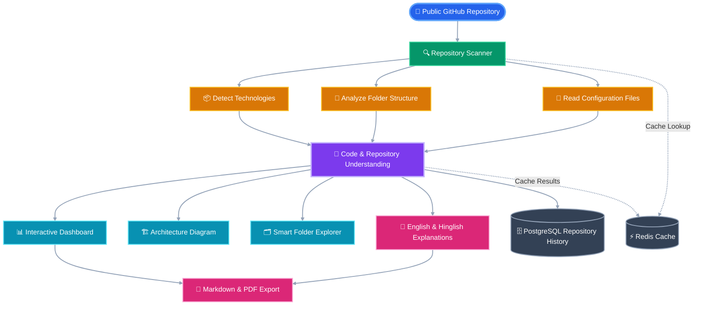

### ✨ What This Diagram Explains

- **Repository Scanner:** Starts the analysis of a public GitHub repository.
- **Technology Detection:** Identifies technologies and frameworks from repository files and dependency manifests.
- **Folder & Configuration Analysis:** Examines the project structure and important configuration files.
- **Code Understanding:** Combines the analysis into a structured repository overview.
- **Interactive Visualizations:** Provides a dashboard, architecture diagram, and folder explorer.
- **Bilingual Reports:** Presents explanations in English or Hinglish and supports Markdown/PDF export.
- **Caching & History:** Uses Redis for caching and PostgreSQL for persistent repository history.
## 🏗️ System Architecture

CodeAtlas is built using a modern, cloud-hosted architecture. The React frontend communicates with the Express.js backend, which analyzes public GitHub repositories and uses PostgreSQL for persistent storage and Redis for caching.

### 🌐 High-Level Architecture

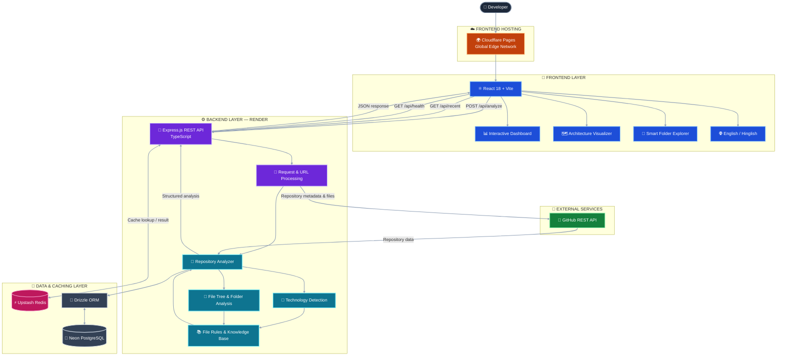

### 🔄 Backend Request Processing

This flow illustrates how CodeAtlas processes a repository analysis request and returns the results to the frontend.

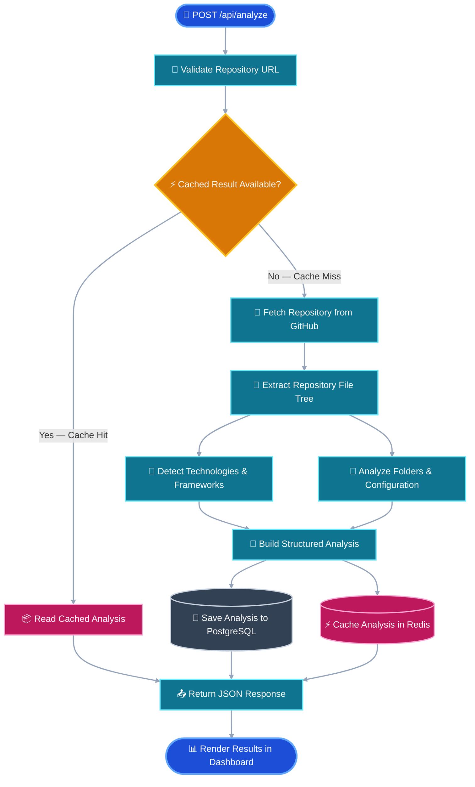

### 📡 API Communication Flow

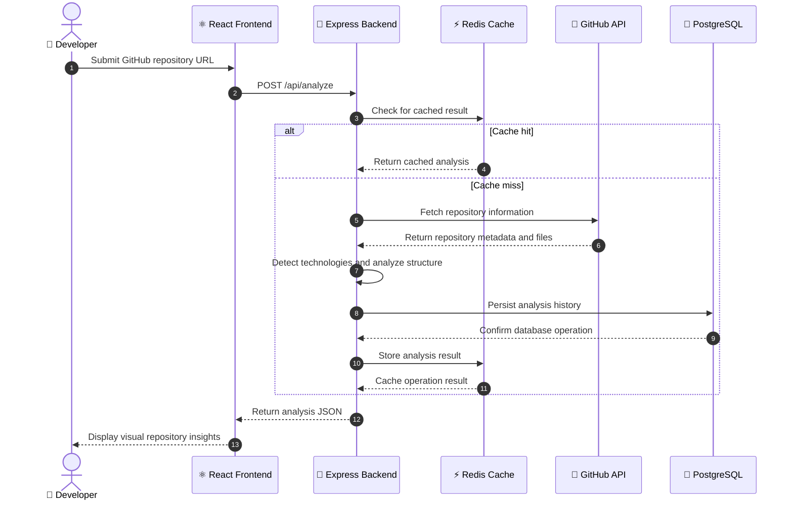

### 🧱 Architecture Components

| Component | Technology | Responsibility |
|---|---|---|
| Frontend | React + Vite | User interface and visualizations |
| Frontend hosting | Cloudflare Pages | Deploys and serves the frontend |
| Backend | Express.js + TypeScript | API endpoints and request processing |
| Repository source | GitHub REST API | Repository metadata and file information |
| Analysis engine | Repository analysis logic | Technology and folder analysis |
| ORM | Drizzle ORM | Database access |
| Persistent storage | Neon PostgreSQL | Stores analyzed repository history |
| Cache | Upstash Redis | Reuses cached analysis results |
| Deployment | Render | Hosts the backend API |

### 🔐 Architecture Benefits

- **Modular design:** Frontend, backend, storage, and external services have separate responsibilities.
- **Faster repeat requests:** Redis can reduce repeated analysis work when a valid cached result exists.
- **Persistent history:** PostgreSQL stores analysis snapshots for recently analyzed repositories.
- **Visual exploration:** Users can understand repository structure through interactive diagrams and folder views.
- **Cloud deployment:** The frontend and backend are deployed independently.

> **Note:** The diagrams describe the intended request flow based on the documented stack. Confirm the exact cache-miss logic, database persistence, and Redis fallback behavior against your implementation before presenting every step as production-verified.
## 🔬 Repository Analysis Workflow

CodeAtlas follows a structured workflow to turn a public GitHub repository into an understandable project overview. It collects repository information, examines the file tree, identifies technologies, analyzes important files, and prepares structured results for visualization.

### 🚀 End-to-End Repository Analysis

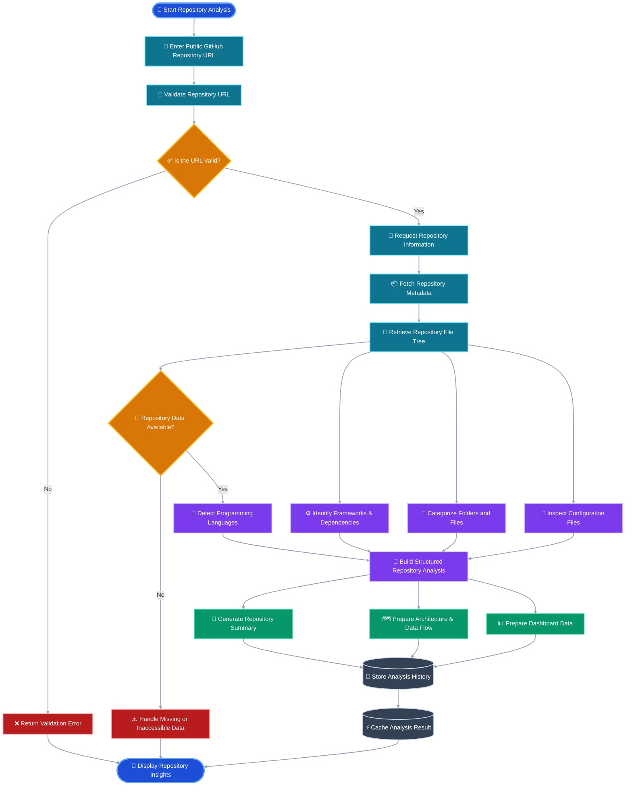

### 🔍 Detailed Analysis Stages

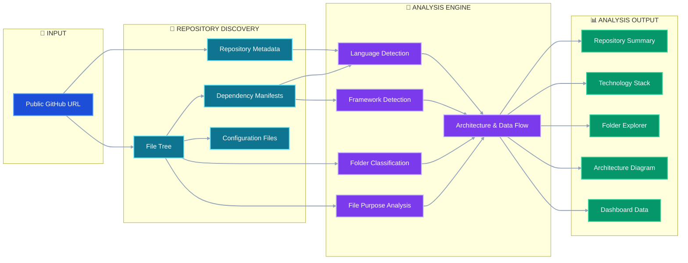

### 📋 Analysis Pipeline Explained

| Stage | Process | Expected Output |
|---|---|---|
| 1. Input | Accept a public GitHub repository URL | Repository URL |
| 2. Validation | Check the submitted URL format | Validated URL or error |
| 3. Discovery | Retrieve repository metadata and file tree | Repository information |
| 4. Detection | Inspect file signatures and dependency manifests | Technologies and frameworks |
| 5. Structure Analysis | Categorize directories and files | Hierarchical folder structure |
| 6. Understanding | Combine the extracted repository information | Structured analysis |
| 7. Visualization | Prepare data for the frontend | Dashboard, folder and architecture views |
| 8. Persistence | Save analysis history and cache results where configured | Stored analysis and cached result |
| 9. Presentation | Return results to the frontend | Interactive repository overview |

### 🧩 Technology Detection Flow

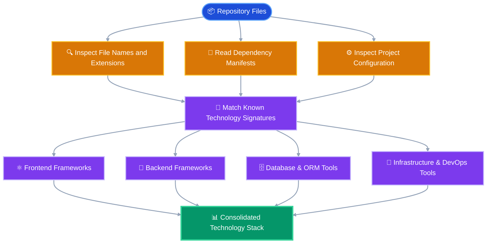

### ✨ Why This Workflow Matters

- **Structured analysis:** Breaks repository inspection into manageable stages.
- **Technology discovery:** Uses file signatures and dependency manifests to identify relevant tools and frameworks.
- **Better code navigation:** Organizes repository files into a more understandable hierarchy.
- **Architecture visibility:** Helps developers understand project components and their relationships.
- **Consistent output:** Prepares structured information that the frontend can display in multiple views.

> **Implementation note:** These diagrams describe the intended analysis pipeline. Actual behavior depends on the repository analyzer's implementation, the GitHub API response, the file types inspected, and the configured caching and persistence logic.
## 💾 Database & Redis Caching Architecture

CodeAtlas uses **Neon PostgreSQL** for persistent repository analysis history and **Upstash Redis** for caching analysis results. This architecture helps retain analyzed repository information and can reduce repeated processing when cached results are available.

### 🏗️ Database & Cache Overview

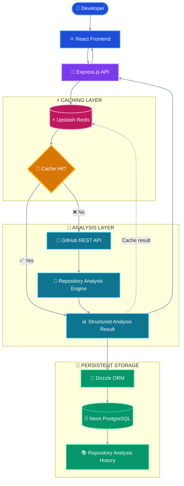

### ⚡ Redis Cache Hit vs Cache Miss

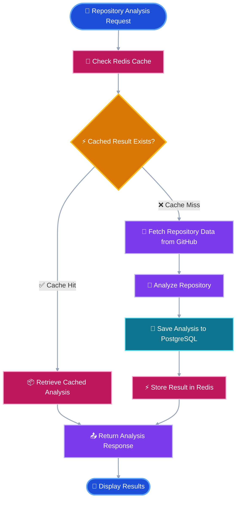

### 🗄️ PostgreSQL Repository History

The `analyses` table stores snapshots of repository information and analysis output.

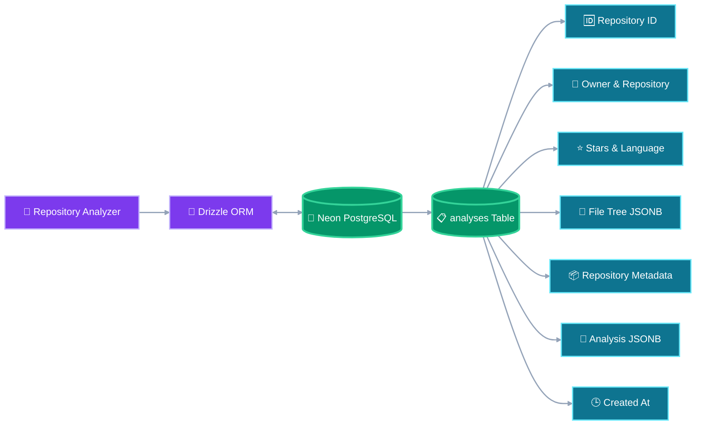

### 📋 Storage Responsibilities

| Component | Responsibility |
|---|---|
| **Upstash Redis** | Caches analysis results for reuse |
| **Neon PostgreSQL** | Persists repository analysis history |
| **Drizzle ORM** | Provides database access from TypeScript |
| **`analyses` table** | Stores repository metadata, file tree, and analysis output |
| **JSONB columns** | Store structured tree, metadata, and analysis data |
| **`created_at`** | Records when an analysis snapshot was created |

### 🚦 Cache Behavior

- **Cache hit:** If a valid cached result is found, the application can reuse it instead of repeating the complete analysis.
- **Cache miss:** The application needs to obtain repository data and perform the necessary analysis.
- **Persistent storage:** PostgreSQL retains analysis records independently of the temporary Redis cache.
- **Cache expiration:** The project documentation specifies a two-hour Redis TTL; verify the configured value in the implementation.
- **Repeated requests:** Reusing cached results can reduce unnecessary API requests and processing time.

> **Implementation note:** The diagrams illustrate the intended caching and persistence workflow. Confirm the actual cache key, expiration settings, database write order, and Redis fallback behavior against your backend source code before treating every step as verified implementation behavior.
## 🔌 API Request & Response Flow

CodeAtlas exposes REST API endpoints for backend health checks, recently analyzed repositories, and GitHub repository analysis.

### 🌐 API Architecture Overview

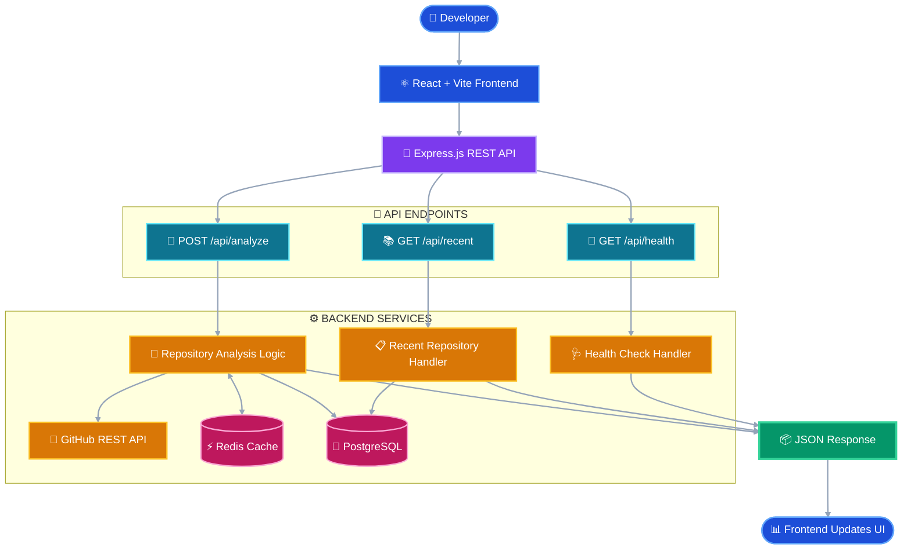

### 💚 API 1 — Health Check

**Endpoint:** `GET /api/health`

Used to check whether the backend health endpoint is responding.

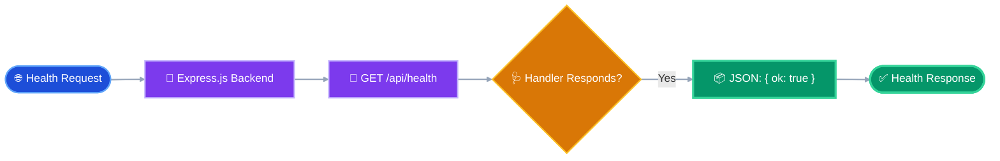

Example response:

```json
{
  "ok": true
}
```

### 📚 API 2 — Recently Analyzed Repositories

**Endpoint:** `GET /api/recent`

Returns recently analyzed repositories for the frontend.

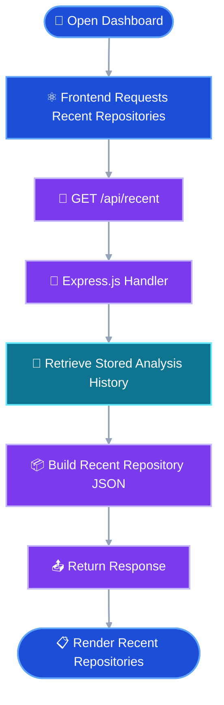

Example response:

```json
{
  "recent": [
    {
      "id": 1,
      "fullName": "Mausam-Kumari9534/CodeAtlass",
      "description": "Smart GitHub Repository Explainer",
      "stars": 12,
      "language": "TypeScript"
    }
  ]
}
```

### 🔬 API 3 — Analyze a GitHub Repository

**Endpoint:** `POST /api/analyze`

Accepts a GitHub repository URL and returns structured repository analysis.

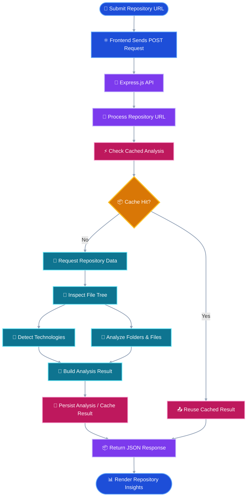

Example request:

```http
POST /api/analyze
Content-Type: application/json
```

```json
{
  "url": "https://github.com/vercel/next.js"
}
```

Example response structure:

```json
{
  "result": {
    "repo": {
      "owner": "vercel",
      "name": "next.js",
      "fullName": "vercel/next.js"
    },
    "summary": "Repository overview in the selected language...",
    "techStack": [],
    "folders": [],
    "files": [],
    "dataFlow": []
  }
}
```

*Note: The request and response examples illustrate the documented API contract. Actual fields and behavior depend on the running backend implementation.*

### 🔄 Complete API Communication Sequence

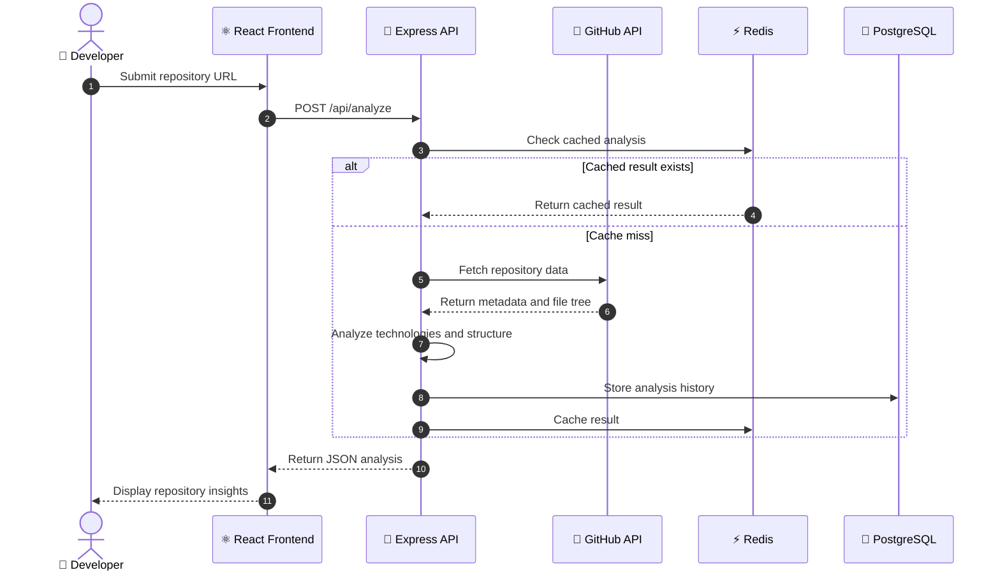

### 📌 API Summary

| Method | Endpoint | Purpose |
|---|---|---|
| `GET` | `/api/health` | Backend health endpoint |
| `GET` | `/api/recent` | Retrieve recent repository analyses |
| `POST` | `/api/analyze` | Analyze a public GitHub repository |

### 🛡️ API Reliability Considerations

- Validate submitted repository URLs before processing.
- Handle inaccessible repositories and GitHub API rate limits gracefully.
- Return meaningful error responses for invalid requests.
- Avoid exposing API tokens or database credentials.
- Use caching where appropriate to reduce repeated work.

> **Implementation note:** The diagrams represent the intended API workflows based on the documented endpoints and technology stack. Verify the actual route handlers, error handling, cache behavior, and database operations in the source code before treating every internal step as production-verified.
## 🔐 Environment Variables & Secure Configuration

CodeAtlas uses environment variables to configure its frontend, backend, database connection, GitHub API access, and optional Redis caching. Keep credentials outside the source code and configure them separately for local development and production deployments.

### 🏗️ Configuration Architecture

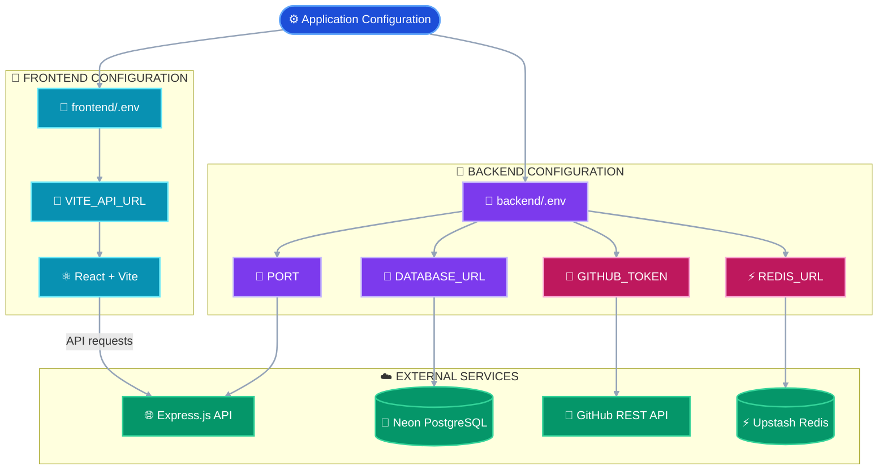

### 🔑 Environment Variables Reference

#### Frontend — `frontend/.env`

```env
VITE_API_URL=http://localhost:3001
```

| Variable | Required | Purpose |
|---|---|---|
| `VITE_API_URL` | Yes | Base URL used by the frontend to communicate with the backend API |

Production example:

```env
VITE_API_URL=https://codeatlass-1.onrender.com
```

#### Backend — `backend/.env`

```env
PORT=3001
DATABASE_URL=your_postgresql_connection_string
GITHUB_TOKEN=your_optional_github_token
REDIS_URL=your_optional_redis_url
```

| Variable | Required | Purpose |
|---|---|---|
| `PORT` | No | Local Express server port; the hosting platform may supply its own port |
| `DATABASE_URL` | Yes | PostgreSQL connection string |
| `GITHUB_TOKEN` | Recommended | Helps with GitHub API rate limits |
| `REDIS_URL` | Optional | Redis connection string for caching |

**Important:** Replace the example values with your own valid configuration. Never publish actual passwords, access tokens, or connection strings.

### 🔄 Local Development Configuration Flow

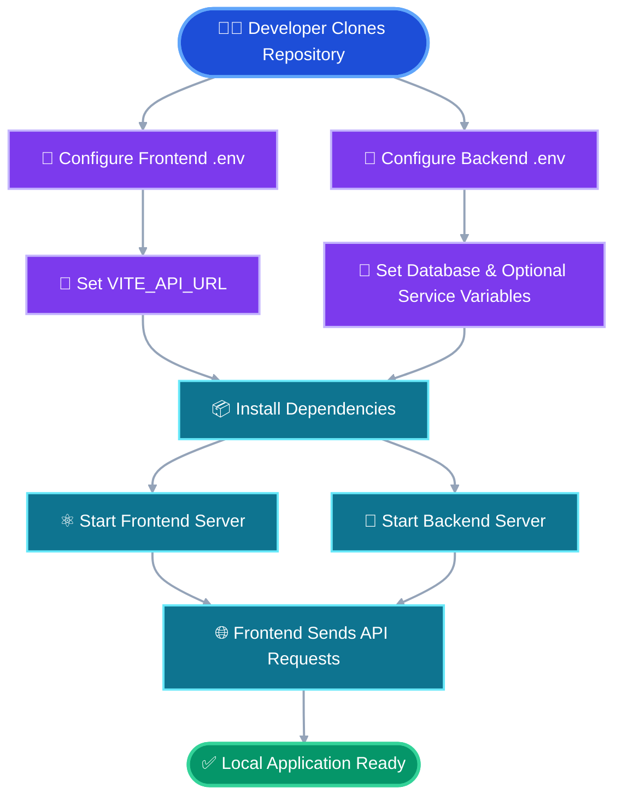

### ☁️ Production Environment Configuration

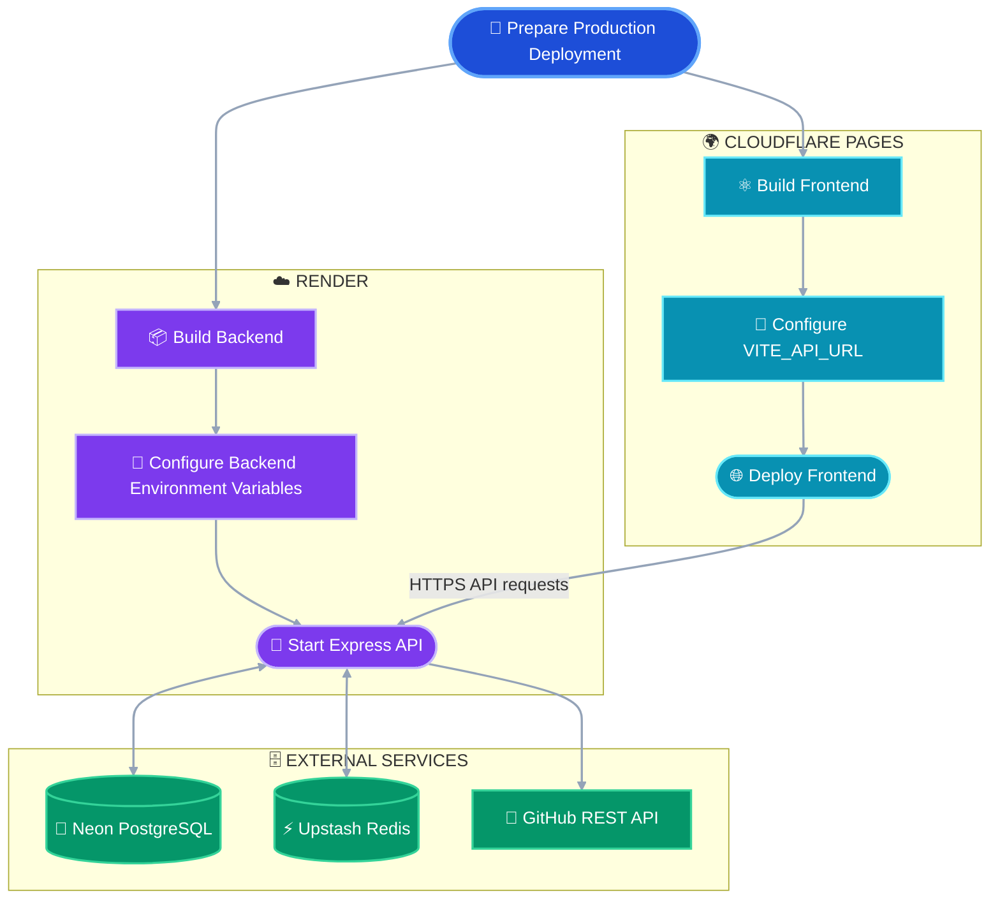

### 🛡️ Security Best Practices

- **Never commit `.env` files:** Add them to `.gitignore`.
- **Protect GitHub tokens:** Store tokens only in backend environment variables or a suitable secret manager.
- **Keep database credentials private:** Never expose `DATABASE_URL` in frontend code.
- **Understand Vite variables:** Variables prefixed with `VITE_` can be exposed to browser-side code. Do not place secrets in them.
- **Use HTTPS in production:** Configure the frontend to call the deployed HTTPS backend.
- **Separate environments:** Use different configuration values for local development and production.
- **Rotate exposed credentials:** If a secret is accidentally pushed to a public repository, revoke or rotate it immediately.

Example `.gitignore` entries:

```gitignore
.env
.env.*
!.env.example
```

Only commit `.env.example` with placeholder values, never actual credentials.

> **Implementation note:** The variable names above follow the project's documented configuration. Confirm that the backend actually reads each variable and that the frontend uses `VITE_API_URL` before deploying.
## 🚀 Local Setup & Deployment Pipeline

Follow these steps to run CodeAtlas locally and deploy its frontend and backend using Cloudflare Pages and Render.

### 🛠️ End-to-End Development Workflow

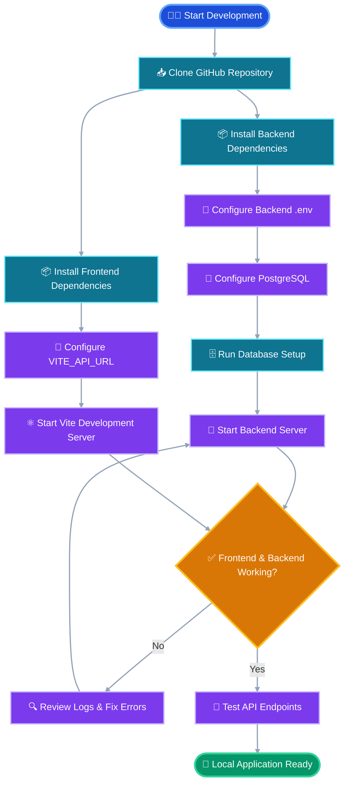

### 💻 Local Setup Commands

#### 1. Clone the Repository

```bash
git clone https://github.com/Mausam-Kumari9534/CodeAtlass.git
cd CodeAtlass
```

#### 2. Install and Configure the Backend

```bash
cd backend
npm install
```

Create `backend/.env`:

```env
PORT=3001
DATABASE_URL=your_postgresql_connection_string
GITHUB_TOKEN=your_optional_github_token
REDIS_URL=your_optional_redis_url
```

Run the database setup command documented by the project:

```bash
npm run db:push
```

Start the backend:

```bash
npm run dev
```

#### 3. Install and Configure the Frontend

Open a second terminal from the project root:

```bash
cd frontend
npm install
```

Create `frontend/.env`:

```env
VITE_API_URL=http://localhost:3001
```

Start the frontend:

```bash
npm run dev
```

Open the local URL printed by Vite, usually `http://localhost:5173`.

### ☁️ Production Deployment Workflow

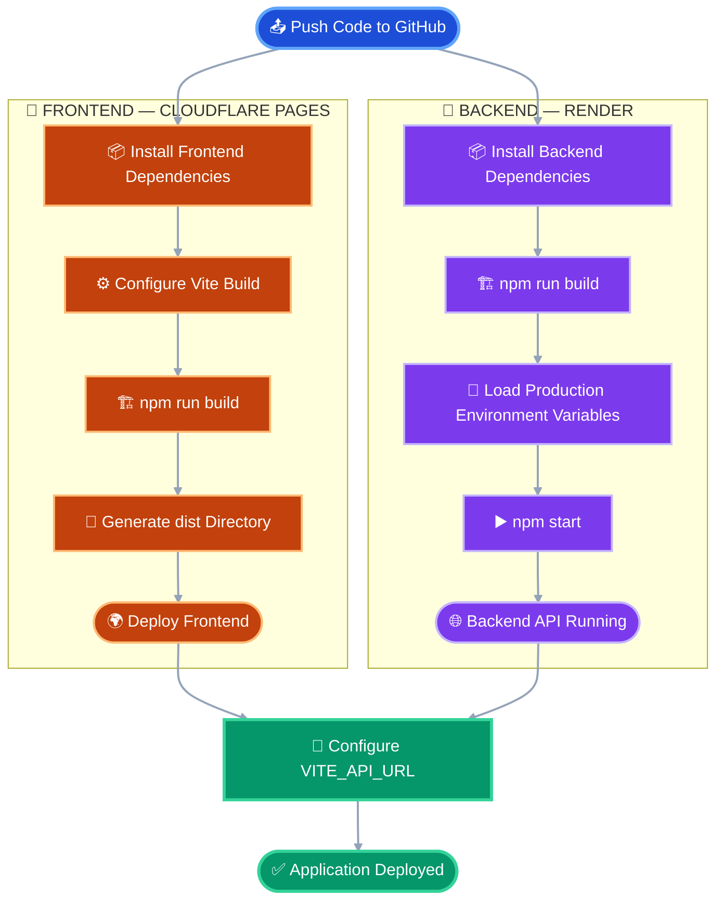

### 🌍 Deployment Configuration

| Setting | Cloudflare Pages | Render |
|---|---|---|
| Application | Frontend | Backend |
| Root directory | `frontend` | `backend` |
| Build command | `npm run build` | `npm install && npm run build` |
| Output / start | `dist` | `npm start` |
| Main configuration | `VITE_API_URL` | `DATABASE_URL`, `GITHUB_TOKEN`, `REDIS_URL` |
| Deployment source | GitHub repository | GitHub repository |

### 🔄 Deployment Verification

After deployment, verify that the services respond correctly.

**Backend health endpoint**

```text
https://codeatlass-1.onrender.com/api/health
```

Expected response according to the documented API:

```json
{
  "ok": true
}
```

**Frontend**

```text
https://codeatlass.pages.dev
```

**Repository analysis API**

```text
POST https://codeatlass-1.onrender.com/api/analyze
Content-Type: application/json
```

Request body:

```json
{
  "url": "https://github.com/vercel/next.js"
}
```

### 🛡️ Deployment Best Practices

- Keep environment variables and secrets out of Git commits.
- Confirm the frontend's `VITE_API_URL` points to the deployed backend.
- Configure backend CORS to allow the production frontend origin.
- Review build logs when a deployment fails.
- Confirm database connectivity and optional Redis availability.
- Verify that the production start command matches the backend's `package.json`.

> **Note:** The commands and deployment settings are based on the project's documented setup. Verify the scripts in both `package.json` files before deploying, especially `npm run build`, `npm start`, and `npm run db:push`.
## 🛡️ Error Handling, Troubleshooting & Reliability

CodeAtlas depends on several components, including the frontend, Express.js API, GitHub REST API, PostgreSQL, and Redis. Diagnosing failures at each layer helps developers troubleshoot issues and maintain a reliable repository analysis workflow.

### 🚦 Error Handling Overview

```mermaid
flowchart TD

    A(["🚀 Repository Analysis Request"])
    B["🔎 Validate Repository URL"]
    C{"✅ URL Valid?"}

    E["❌ Return Validation Error"]
    D["🌐 Contact Backend API"]
    F{"📡 Backend Responding?"}

    G["⚠️ Check Backend Logs"]
    H["⚡ Check Redis Cache"]
    I{"🎯 Cache Available?"}

    J["📦 Reuse Cached Result"]
    K["🐙 Fetch GitHub Repository"]
    L{"📥 GitHub Data Available?"}

    M["⚠️ Check URL, Permissions & Rate Limits"]
    N["🧠 Analyze Repository Structure"]
    O{"🔬 Analysis Successful?"}

    P["🔍 Inspect Analyzer Logs"]
    Q["🐘 Verify PostgreSQL Connection"]
    R["💾 Persist Analysis When Configured"]
    S["📤 Return JSON Response"]
    T(["📊 Display Results"])

    A --> B
    B --> C

    C -->|"No"| E
    C -->|"Yes"| D

    D --> F
    F -->|"No"| G
    F -->|"Yes"| H

    H --> I
    I -->|"Yes"| J
    I -->|"No"| K

    K --> L
    L -->|"No"| M
    L -->|"Yes"| N

    N --> O
    O -->|"No"| P
    O -->|"Yes"| Q

    Q --> R
    R --> S
    J --> S
    S --> T

    classDef start fill:#1D4ED8,stroke:#60A5FA,color:#FFFFFF,stroke-width:3px
    classDef process fill:#0E7490,stroke:#67E8F9,color:#FFFFFF,stroke-width:2px
    classDef decision fill:#D97706,stroke:#FBBF24,color:#FFFFFF,stroke-width:3px
    classDef error fill:#B91C1C,stroke:#FCA5A5,color:#FFFFFF,stroke-width:2px
    classDef cache fill:#BE185D,stroke:#F9A8D4,color:#FFFFFF,stroke-width:2px
    classDef success fill:#059669,stroke:#34D399,color:#FFFFFF,stroke-width:3px

    class A,T start
    class B,D,K,N,Q,R,S process
    class C,F,I,L,O decision
    class E,G,M,P error
    class H,J cache

    linkStyle default stroke:#94A3B8,stroke-width:2px
```

### 🔍 Common Failure Scenarios

```mermaid
flowchart TD

    A(["⚠️ Application Issue"])

    B{"🔎 Which Component Failed?"}

    C["🌐 Frontend / API Connection"]
    D["🐙 GitHub API"]
    E["🐘 PostgreSQL"]
    F["⚡ Redis"]
    G["☁️ Deployment"]

    C1["Check VITE_API_URL, CORS & Network"]
    D1["Check Repository URL, Access & Rate Limits"]
    E1["Check DATABASE_URL, Credentials & Connectivity"]
    F1["Check REDIS_URL & Cache Client Logs"]
    G1["Inspect Build Logs, Environment & Start Command"]

    R["🛠️ Apply Fix"]
    V["🧪 Retry the Relevant Request"]
    Z(["✅ Verify Recovery"])

    A --> B

    B --> C
    B --> D
    B --> E
    B --> F
    B --> G

    C --> C1
    D --> D1
    E --> E1
    F --> F1
    G --> G1

    C1 --> R
    D1 --> R
    E1 --> R
    F1 --> R
    G1 --> R

    R --> V
    V --> Z

    classDef start fill:#1D4ED8,stroke:#60A5FA,color:#FFFFFF,stroke-width:3px
    classDef decision fill:#D97706,stroke:#FBBF24,color:#FFFFFF,stroke-width:2px
    classDef frontend fill:#0891B2,stroke:#67E8F9,color:#FFFFFF,stroke-width:2px
    classDef external fill:#7C3AED,stroke:#C4B5FD,color:#FFFFFF,stroke-width:2px
    classDef database fill:#059669,stroke:#34D399,color:#FFFFFF,stroke-width:2px
    classDef cache fill:#BE185D,stroke:#F9A8D4,color:#FFFFFF,stroke-width:2px
    classDef fix fill:#334155,stroke:#CBD5E1,color:#FFFFFF,stroke-width:2px

    class A,Z start
    class B decision
    class C,C1 frontend
    class D,D1 external
    class E,E1 database
    class F,F1 cache
    class G,G1,R,V fix

    linkStyle default stroke:#94A3B8,stroke-width:2px
```

### 🐙 GitHub API Failure Handling

```mermaid
flowchart TD

    A(["🐙 Fetch Repository Data"])
    B{"📡 GitHub API Request Successful?"}

    C["📦 Process Repository Response"]
    D{"🔢 Error Category?"}

    E["🔐 Verify Repository URL & Permissions"]
    F["⏳ Check API Rate Limit & Retry Timing"]
    G["🌐 Check Network or GitHub Availability"]

    H["📝 Log Diagnostic Information"]
    I["📤 Return Appropriate Error Response"]
    J(["📊 Update Frontend State"])

    A --> B

    B -->|"Yes"| C
    B -->|"No"| D

    D -->|"401 / 403"| E
    D -->|"429 or rate limit"| F
    D -->|"Network / server error"| G

    E --> H
    F --> H
    G --> H

    H --> I
    I --> J

    classDef start fill:#1D4ED8,stroke:#60A5FA,color:#FFFFFF,stroke-width:3px
    classDef process fill:#0E7490,stroke:#67E8F9,color:#FFFFFF,stroke-width:2px
    classDef decision fill:#D97706,stroke:#FBBF24,color:#FFFFFF,stroke-width:2px
    classDef error fill:#B91C1C,stroke:#FCA5A5,color:#FFFFFF,stroke-width:2px
    classDef success fill:#059669,stroke:#34D399,color:#FFFFFF,stroke-width:2px

    class A,J start
    class C,H,I process
    class B,D decision
    class E,F,G error

    linkStyle default stroke:#94A3B8,stroke-width:2px
```

### 🧰 Troubleshooting Reference

| Symptom | What to check | Suggested action |
|---|---|---|
| Frontend cannot reach backend | `VITE_API_URL`, CORS and network requests | Confirm the API URL and allowed frontend origin |
| Invalid repository response | GitHub URL format and API response | Validate the URL and handle inaccessible repositories |
| GitHub rate limit | API response and rate-limit headers | Use an appropriate token and respect retry timing |
| Database connection failure | `DATABASE_URL`, credentials and connectivity | Verify the connection string and database availability |
| Redis connection failure | `REDIS_URL` and Redis client logs | Check credentials and connectivity; use fallback only if implemented |
| Missing environment variable | Local `.env` or deployment settings | Add the required variable and restart or redeploy |
| Build failure | Build logs and dependency versions | Fix the first relevant build error and rebuild |
| Backend does not start | Start command, port and runtime logs | Verify `npm start`, required scripts and platform port configuration |

### 🩺 Reliability Best Practices

- **Validate input early:** Reject malformed repository URLs before making external requests.
- **Handle external failures:** Account for inaccessible repositories, API rate limits, and network errors.
- **Protect sensitive information:** Avoid logging access tokens, passwords, or full connection strings.
- **Use bounded retries:** Retry transient failures carefully and respect API rate-limit instructions.
- **Monitor service health:** Check backend health endpoints and deployment logs.
- **Test cache failure behavior:** Confirm whether the application can continue without Redis before documenting fallback support.
- **Verify database operations:** Handle failed database writes explicitly and avoid reporting persistence as successful when it failed.
- **Return meaningful errors:** Provide clear, safe messages to users without exposing internal implementation details.

> **Implementation note:** This section describes recommended error-handling and troubleshooting practices. It does not imply that every retry, fallback, monitoring mechanism, or error branch is already implemented in CodeAtlas. Verify these behaviors against the actual source code.

## 🧪 Testing Strategy & Quality Assurance

Testing helps verify that CodeAtlas components work together correctly, repository analysis produces usable results, and deployment configuration is correct. The following workflows describe a recommended testing strategy for the application.

### 🏗️ End-to-End Testing Workflow

```mermaid
flowchart TD

    A(["🚀 Start Testing"])
    B["📋 Review Requirements & Expected Behavior"]

    subgraph UNIT["🧩 COMPONENT TESTING"]
        C["⚛️ Frontend Components"]
        D["🔌 API Route Handlers"]
        E["🧠 Repository Analysis Logic"]
    end

    subgraph INTEGRATION["🔗 INTEGRATION TESTING"]
        F["🐙 GitHub API Integration"]
        G["🐘 PostgreSQL Connectivity"]
        H["⚡ Redis Cache Behavior"]
    end

    subgraph E2E["🌐 APPLICATION TESTING"]
        I["📨 Test API Requests"]
        J["📊 Verify Dashboard Results"]
        K["🔄 Test Complete Repository Analysis"]
    end

    L{"✅ Expected Results Received?"}
    M["🔍 Investigate Failure & Fix"]
    N["🔁 Run Relevant Tests Again"]
    O(["🎉 Testing Complete"])

    A --> B
    B --> C
    B --> D
    B --> E

    C --> F
    D --> G
    E --> H

    F --> I
    G --> I
    H --> I

    I --> J
    J --> K
    K --> L

    L -->|"No"| M
    M --> N
    N --> C

    L -->|"Yes"| O

    classDef start fill:#1D4ED8,stroke:#60A5FA,color:#FFFFFF,stroke-width:3px
    classDef unit fill:#7C3AED,stroke:#C4B5FD,color:#FFFFFF,stroke-width:2px
    classDef integration fill:#0E7490,stroke:#67E8F9,color:#FFFFFF,stroke-width:2px
    classDef e2e fill:#D97706,stroke:#FBBF24,color:#FFFFFF,stroke-width:2px
    classDef decision fill:#BE185D,stroke:#F9A8D4,color:#FFFFFF,stroke-width:3px
    classDef success fill:#059669,stroke:#34D399,color:#FFFFFF,stroke-width:3px

    class A start
    class B,C,D,E unit
    class F,G,H integration
    class I,J,K e2e
    class L decision
    class M,N unit
    class O success

    linkStyle default stroke:#94A3B8,stroke-width:2px
```

### 🔌 API Testing Workflow

```mermaid
flowchart TD

    A(["🧪 Start API Tests"])
    B["🌐 Send HTTP Request"]
    C{"🔌 Which Endpoint?"}

    D["💚 GET /api/health"]
    E["📚 GET /api/recent"]
    F["🔬 POST /api/analyze"]

    G["📦 Validate Status & Response"]
    H["🧾 Validate JSON Structure"]
    I["🔍 Check Expected Fields"]
    J{"✅ Assertions Passed?"}

    K["❌ Record Test Failure"]
    L["🛠️ Investigate & Fix"]
    M(["✅ Record Test Success"])

    A --> B
    B --> C

    C --> D
    C --> E
    C --> F

    D --> G
    E --> G
    F --> G

    G --> H
    H --> I
    I --> J

    J -->|"No"| K
    K --> L
    J -->|"Yes"| M

    classDef start fill:#1D4ED8,stroke:#60A5FA,color:#FFFFFF,stroke-width:3px
    classDef request fill:#7C3AED,stroke:#C4B5FD,color:#FFFFFF,stroke-width:2px
    classDef validate fill:#0E7490,stroke:#67E8F9,color:#FFFFFF,stroke-width:2px
    classDef decision fill:#D97706,stroke:#FBBF24,color:#FFFFFF,stroke-width:3px
    classDef error fill:#B91C1C,stroke:#FCA5A5,color:#FFFFFF,stroke-width:2px
    classDef success fill:#059669,stroke:#34D399,color:#FFFFFF,stroke-width:3px

    class A start
    class B,C,D,E,F request
    class G,H,I validate
    class J decision
    class K,L error
    class M success

    linkStyle default stroke:#94A3B8,stroke-width:2px
```

### 🧩 Repository Analysis Test Cases

| Test case | Input / condition | Expected behavior |
|---|---|---|
| Valid repository | Accessible public GitHub URL | Return repository analysis |
| Invalid URL | Malformed repository URL | Handle the invalid input safely |
| Missing repository | Non-existent repository | Return an appropriate error |
| Empty or unusual file tree | Repository with limited files | Handle available data without crashing |
| Technology detection | Repository with known manifests | Identify supported technologies |
| Recent repositories | Request `/api/recent` | Return the documented response structure |
| Cache hit | Previously cached analysis | Reuse the result if cache logic supports it |
| Cache unavailable | Redis connection failure | Follow the implemented failure or fallback behavior |
| Database unavailable | PostgreSQL connection failure | Handle persistence failure appropriately |
| GitHub rate limit | API quota exceeded | Handle the response and retry timing safely |

### 🗄️ Database & Cache Integration Testing

```mermaid
flowchart TD

    A(["🔗 Start Integration Tests"])
    B["🧪 Submit Repository Analysis"]
    C["📦 Inspect Analysis Response"]
    D["🐘 Verify PostgreSQL Record"]
    E["⚡ Verify Redis Cache Behavior"]
    F{"✅ Data & Cache Behave as Expected?"}

    G["🔍 Inspect Queries, Keys & Logs"]
    H["🛠️ Correct the Implementation"]
    I(["🎉 Integration Tests Passed"])

    A --> B
    B --> C
    C --> D
    D --> E
    E --> F

    F -->|"No"| G
    G --> H
    H --> B

    F -->|"Yes"| I

    classDef start fill:#1D4ED8,stroke:#60A5FA,color:#FFFFFF,stroke-width:3px
    classDef process fill:#7C3AED,stroke:#C4B5FD,color:#FFFFFF,stroke-width:2px
    classDef database fill:#0E7490,stroke:#67E8F9,color:#FFFFFF,stroke-width:2px
    classDef decision fill:#D97706,stroke:#FBBF24,color:#FFFFFF,stroke-width:3px
    classDef success fill:#059669,stroke:#34D399,color:#FFFFFF,stroke-width:3px

    class A start
    class B,C,G,H process
    class D,E database
    class F decision
    class I success

    linkStyle default stroke:#94A3B8,stroke-width:2px
```

### ☁️ Production Smoke Testing

After deploying the frontend and backend, perform basic checks to confirm that the services are reachable.

```mermaid
flowchart TD

    A(["🚀 Deployment Completed"])
    B["🌐 Open Production Frontend"]
    C["💚 Check Backend Health Endpoint"]
    D["📚 Test Recent Repositories Endpoint"]
    E["🔬 Test Repository Analysis"]
    F["🖥️ Inspect Browser Console & Network"]
    G{"✅ Critical Checks Passed?"}

    H["📋 Review Hosting Logs & Configuration"]
    I["🛠️ Fix & Redeploy"]
    J(["🎉 Smoke Tests Passed"])

    A --> B
    B --> C
    C --> D
    D --> E
    E --> F
    F --> G

    G -->|"No"| H
    H --> I
    I --> B

    G -->|"Yes"| J

    classDef start fill:#1D4ED8,stroke:#60A5FA,color:#FFFFFF,stroke-width:3px
    classDef check fill:#0E7490,stroke:#67E8F9,color:#FFFFFF,stroke-width:2px
    classDef decision fill:#D97706,stroke:#FBBF24,color:#FFFFFF,stroke-width:3px
    classDef fix fill:#BE185D,stroke:#F9A8D4,color:#FFFFFF,stroke-width:2px
    classDef success fill:#059669,stroke:#34D399,color:#FFFFFF,stroke-width:3px

    class A start
    class B,C,D,E,F check
    class G decision
    class H,I fix
    class J success

    linkStyle default stroke:#94A3B8,stroke-width:2px
```

### 📋 Quality Assurance Checklist

Use this checklist before releasing a new version.

- [ ] Frontend builds successfully.
- [ ] Backend starts with the required environment variables.
- [ ] Health endpoint returns the expected response.
- [ ] Recent repositories endpoint returns valid JSON.
- [ ] Repository analysis works with an accessible public repository.
- [ ] Invalid and inaccessible repository URLs are handled safely.
- [ ] PostgreSQL persistence is verified.
- [ ] Redis behavior is verified when configured.
- [ ] Frontend and backend communicate correctly in production.
- [ ] No credentials or tokens are exposed in the repository.
- [ ] Deployment logs have been checked for relevant errors.

> **Testing note:** These are recommended test cases and workflows, not a claim that an automated test suite already exists. Use the test runner and scripts defined in the project's actual `package.json` files.

## ⚙️ Part 10: CI/CD Automation & GitHub Actions

CodeAtlas can use GitHub Actions to automate code validation and deployment-related tasks. The workflow below represents a recommended CI/CD pipeline; ensure each step matches the actual configuration in `.github/workflows/` before presenting it as implemented.

### 🔄 CI/CD Pipeline Overview

```mermaid
%%{init: {'theme':'base','themeVariables': {
  'primaryColor':'#dbeafe',
  'primaryTextColor':'#1e3a8a',
  'primaryBorderColor':'#3b82f6',
  'lineColor':'#64748b',
  'secondaryColor':'#dcfce7',
  'tertiaryColor':'#f3e8ff',
  'fontFamily':'Arial'
}}}%%
flowchart TD
    A(["👨‍💻 Developer"]) --> B["📦 Commit & Push"]
    B --> C["🐙 GitHub Repository"]
    C --> D{"⚡ Workflow Trigger"}
    D --> E["📥 Checkout Code"]
    E --> F["🟢 Setup Node.js"]
    F --> G["📚 Install Dependencies"]
    G --> H["🔍 Lint & Type Checks"]
    H --> I["🧪 Run Tests"]
    I --> J["🏗️ Build Application"]
    J --> K{"✅ All Checks Passed?"}

    K -- Yes --> L["🚀 Deployment Stage"]
    K -- No --> M["❌ Workflow Failed"]
    L --> N["☁️ Deploy Frontend"]
    L --> O["🖥️ Deploy Backend"]
    N --> P(["🌐 CodeAtlas Live"])
    O --> P
    M --> Q["🛠️ Review Logs & Fix"]
    Q --> B

    classDef dev fill:#fef3c7,stroke:#d97706,color:#78350f,stroke-width:2px
    classDef github fill:#dbeafe,stroke:#2563eb,color:#1e3a8a,stroke-width:2px
    classDef build fill:#f3e8ff,stroke:#9333ea,color:#581c87,stroke-width:2px
    classDef success fill:#dcfce7,stroke:#16a34a,color:#14532d,stroke-width:2px
    classDef failure fill:#fee2e2,stroke:#dc2626,color:#7f1d1d,stroke-width:2px

    class A,B dev
    class C,D,E github
    class F,G,H,I,J build
    class K,L,N,O,P success
    class M,Q failure
```

### 🧩 Pipeline Stages

| Stage | Purpose |
|---|---|
| 📥 Checkout | Fetch the repository source code |
| 🟢 Setup | Configure the required Node.js version |
| 📚 Install | Install project dependencies |
| 🔍 Validate | Run configured linting and type checks |
| 🧪 Test | Execute available automated tests |
| 🏗️ Build | Verify that the application builds successfully |
| 🚀 Deploy | Publish frontend/backend when deployment is configured |

### 🔐 Recommended CI/CD Best Practices

- Store sensitive credentials in **GitHub Actions Secrets**, not directly in workflow files.
- Pin the Node.js version to one supported by the project.
- Run validation and build checks before deployment.
- Use separate staging and production environments when needed.
- Restrict production deployments to trusted branches or approved releases.
- Review workflow logs when a job fails.
- Avoid printing API keys, database URLs, or tokens in logs.

### 📁 Workflow File Location

GitHub Actions workflow files are normally stored in:

```text
.github/
└── workflows/
    ├── ci.yml
    └── deploy.yml
```

These filenames are examples. Keep the filenames and steps consistent with the workflows actually present in your repository.

### ✅ Expected Outcome

A properly configured pipeline helps catch errors before deployment, reduces repetitive manual work, and makes CodeAtlas releases more consistent.

**Note:** GitHub Actions does not automatically deploy the application merely because a workflow file exists. Configure the required build commands, secrets, deployment provider and triggers first.


---

<!-- ═══════════════ CODEATLAS README FOOTER ═══════════════ -->

<div align="center">

## 🌟 Explore. Understand. Build.

**Making complex GitHub repositories easier to understand, one project at a time.**

<br/>

[](https://codeatlass.pages.dev)
[](https://codeatlass-1.onrender.com/api/health)
[](https://github.com/Mausam-Kumari9534/CodeAtlass/issues)

<br/>

### 💻 Built With


<br/>

### 🤝 Contribute & Collaborate

Found a bug or have an idea to improve CodeAtlas?

[Open an Issue](https://github.com/Mausam-Kumari9534/CodeAtlass/issues) ·
[Contribute to the Project](#-contributing)

<br/>

### 📄 License

This project is licensed under the **MIT License**. See the `LICENSE` file for details.

<br/>

**Built with ❤️ by Mausam Kumari & Contributors**

<br/>

⭐ If you find this project useful, consider giving it a star on GitHub!

<br/>

[⬆️ Back to Top](#-codeatlas)

</div>

<!-- ═══════════════ END README FOOTER ═══════════════ -->
